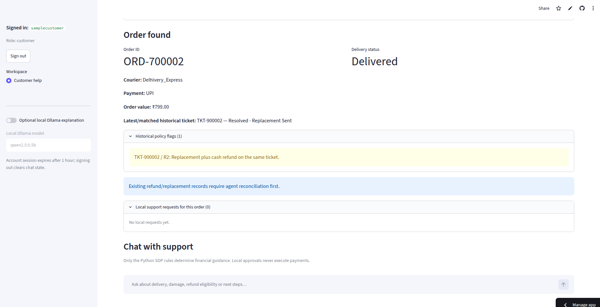
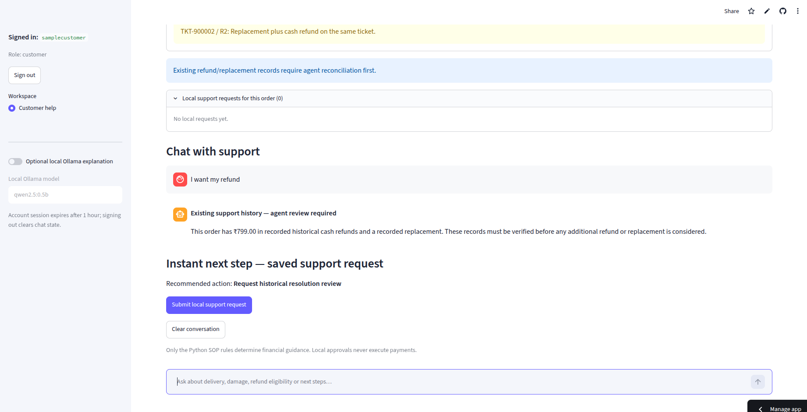
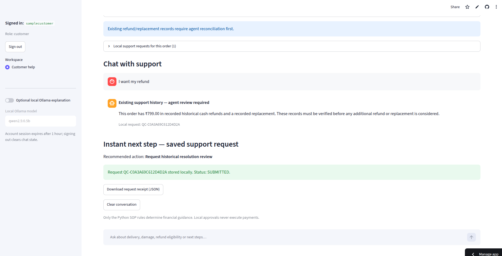
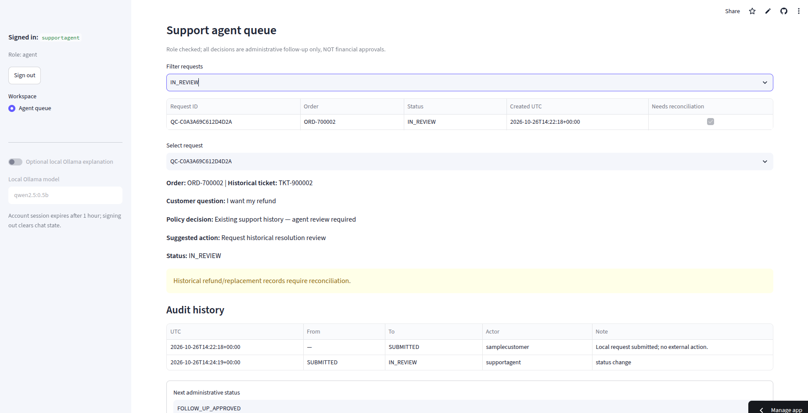
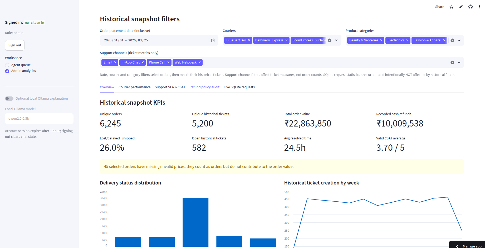
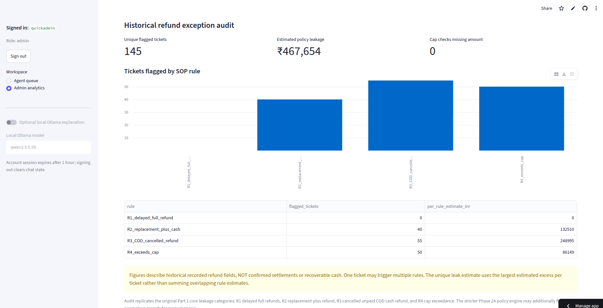

# QuickCart — Customer Support AI & Operations Analytics

**An end-to-end e-commerce support and analytics application that connects cleaned order data, auditable refund policies, customer conversations, support-ticket workflows, and operations reporting.**

**[Live Application](https://quickcart-main-project.streamlit.app/)** · **[Screenshots](#application-screenshots)** · **[Features](#key-features)** · **[Architecture](#system-architecture)** · **[Run Locally](#getting-started)**

> **Project scope:** A functional educational/portfolio prototype, not a connected commerce platform. It never initiates refunds, vouchers, replacements, or courier updates. All financial guidance is determined by the written SOP; administrative approvals authorize follow-up only.

---

## Project overview

QuickCart is a case-study project built around real-world-style data quality problems and support operations. It combines **Part 1: data engineering and root-cause analytics** with **Part 2: a working customer support web application**.

Customers can check their own orders, ask questions, and submit support requests. Support agents can review the requests and maintain an audit trail. Administrators can explore delivery performance, support SLAs, CSAT, and historical refund-policy exceptions.

**The hosted application uses the original cleaned case-study data.** A separate [synthetic-only demo repository](https://github.com/SakshamSingh5224/quickcart-public-demo) is maintained for demonstrations that do not need the original data.

## Application screenshots

*Captured from the working main application. Select an image to view it in full size.*

| Customer order lookup | Policy-aware support chat |
|:---:|:---:|
|  |  |
| **Saved customer request** | **Support agent queue** |
|  |  |
| **Operations overview** | **Refund policy audit** |
|  |  |

## Key features

| Workspace | What it provides |
|---|---|
| **Customer Help** | Account-scoped order/ticket lookup; delivery and payment details; conversational follow-ups; SOP-based refund/replacement guidance; saved support requests and downloadable JSON receipts. |
| **Agent Queue** | Review submitted requests, inspect policy decisions, add review notes, move requests through permitted status transitions, and inspect an audit trail of changes. |
| **Admin Analytics** | Historical order KPIs, courier comparisons, support SLA and CSAT metrics, rule-specific refund exception analysis, CSV summary exports, and current SQLite request counts. |

**Policy controls:** A deterministic Python engine evaluates the four QuickCart SOP rules, including lost/returned shipments, delayed-in-transit guidance, replacement *or* full refund for damaged goods, unpaid cancelled COD orders, and the refund cap of **order amount + ₹100**. Conflicting historical records trigger **agent reconciliation**, not an additional financial recommendation.

**Conversational layer:** The application retains chat context within the Streamlit session. Optional **Ollama** generates supplementary local-language explanations; it does **not** override the policy decision. The hosted app does not provide a cloud-hosted Ollama service.

**Identity and workflow:** Customer order ownership checks, agent/admin role separation, salted password hashes, login throttling, a one-hour session timeout, idempotent request submission, and SQLite-backed audit records.

## Analytics highlights

Results from the cleaned, **unfiltered historical dataset** (Part 1):

| Metric | Result |
|---|---:|
| Unique orders | **6,245** |
| Unique support tickets | **5,200** |
| Total order value | **₹2,28,63,850** |
| Recorded cash refunds | **₹1,00,09,538** |
| Open historical tickets | **582** |
| Average resolution time (resolved tickets) | **24.47 hours** |
| Average valid CSAT | **3.70 / 5** |
| Tickets with core SOP exceptions | **145** |
| Estimated refund-policy leakage | **₹4,67,654** |

**Breakdown of the 145 flagged tickets:** 40 replacement-plus-cash conflicts (Rule 2), 55 unpaid cancelled COD refunds (Rule 3), and 50 amounts above the permitted cap (Rule 4). The original delayed-full-refund check (Rule 1) flagged zero tickets.

**Interpretation:** Leakage is an *estimated excess inferred from historical records*, not proof of settled payments or recovered losses. Dashboard metrics distinguish historical CSV tickets from newly submitted SQLite support requests. The dashboard's lost/delayed rate uses **shipped orders** as its denominator; the original Part 1 courier summary also includes an all-orders rate.

More detail: [Part 1 results](part1/README_Part1.md) · [Dashboard methodology](PHASE_2D_NOTES.md).

## System architecture

~~~mermaid
flowchart TD
    UI["Streamlit web application"] --> AUTH["Authentication and role checks"]
    AUTH --> CUSTOMER["Customer Help"]
    AUTH --> AGENT["Agent Queue"]
    AUTH --> ADMIN["Admin Analytics"]
    CUSTOMER --> CHAT["Conversation context"]
    CHAT --> POLICY["Deterministic SOP engine + historical audit"]
    CHAT -. optional local explanation .-> LLM["Ollama"]
    CUSTOMER --> CSV["Cleaned order and ticket CSVs"]
    POLICY --> CSV
    CUSTOMER --> DB["SQLite: support requests + audit events"]
    AGENT --> DB
    ADMIN --> ANALYTICS["Pandas analytics"]
    ANALYTICS --> CSV
    ANALYTICS --> DB
~~~

**Key modules**

| File / directory | Responsibility |
|---|---|
| `app.py` | Streamlit application and role-specific workspaces |
| `auth_store.py` + `access_control.py` | Password-backed accounts, access controls, customer ownership |
| `conversation.py` | Conversational context and optional Ollama explanation |
| `policy_engine.py` + `policy_audit.py` | SOP decisions and historical refund checks |
| `ticket_store.py` | SQLite requests, administrative transitions and audit events |
| `analytics.py` + `dashboard_ui.py` | Aggregations, charts and filtered admin dashboard |
| `data/` + `part1/` | Cleaned case-study data, cleaning scripts, analysis and charts |
| `tests/` + `.github/workflows/ci.yml` | Regression/security tests and automated CI |

## Technology stack

**Python 3.11** · **Streamlit** · **Pandas** · **SQLite** · **pytest** · **GitHub Actions** · **Ollama (optional, local)**

The primary app requires no paid API. Historical shipping information is a **dataset snapshot** rather than a live courier feed.

## Getting started

### 1. Clone and install

~~~bash
git clone https://github.com/SakshamSingh5224/quickcart-support-ai.git
cd quickcart-support-ai

python3 -m venv .venv
source .venv/bin/activate
python -m pip install -r requirements.txt
~~~

> For Windows, activate the environment with `.venv\Scripts\activate` instead of `source .venv/bin/activate`.

### 2. Create local accounts

The setup prompts for passwords; no default login credentials are committed.

~~~bash
python -m scripts.manage_users create --username quickadmin --role admin
python -m scripts.manage_users create --username supportagent --role agent
python -m scripts.manage_users create --username samplecustomer --role customer --customer-id CUST-12232
~~~

`CUST-12232` owns the historical example order `ORD-700002`. Use separate, strong passwords for each account.

### 3. Run the application

~~~bash
streamlit run app.py --server.address 127.0.0.1
~~~

Open **http://127.0.0.1:8501**.

### 4. Try an end-to-end workflow

1. Sign in as `samplecustomer`, load `ORD-700002`, and ask: **“My item arrived broken. Can I get a refund?”**
2. Inspect the historical **Rule 2 replacement + cash** conflict. The assistant recommends an agent review, not another automatic refund.
3. Select **Submit local support request** and note the generated request ID.
4. Sign out; sign in as `supportagent`. Find the request, add a note, and move it from `SUBMITTED` to `IN_REVIEW`.
5. Sign in as `quickadmin`. Open **Admin Analytics** to explore the five dashboard tabs and the separate SQLite request statistics.

**Permissions**

| Role | Customer Help | Agent Queue | Admin Analytics |
|---|:---:|:---:|:---:|
| Customer | Own records | — | — |
| Support agent | — | ✓ | — |
| Administrator | — | ✓ | ✓ |

## Tests and continuous integration

Run the complete local suite:

~~~bash
python -m pytest -q
~~~

Run the dataset-independent tests used in CI:

~~~bash
python -m pytest -q -m "not original_dataset"
~~~

[GitHub Actions](https://github.com/SakshamSingh5224/quickcart-support-ai/actions/workflows/ci.yml) installs dependencies, runs source-only tests, compiles Python files and validates the synthetic-data export.

## Deployment and data responsibility

- **Main application:** [quickcart-main-project.streamlit.app](https://quickcart-main-project.streamlit.app/) — uses the original case-study dataset included in this repository, published with the project owner's stated permission.
- **Synthetic alternative:** [quickcart-public-demo](https://github.com/SakshamSingh5224/quickcart-public-demo) — generates fabricated orders and tickets for a separate demo.
- **Cloud storage:** Local SQLite on Streamlit Community Cloud is **ephemeral**. Accounts, newly submitted support requests and audit history may reset after restarts or redeployments; the committed historical CSV snapshot remains.
- **Security:** This authentication system is educational. For production use, add managed identity/OIDC, MFA, durable managed storage, monitoring and formal security review. Never publish passwords or application secrets.
- **Actions:** No real refunds, replacements, vouchers, notifications or courier updates are executed.

Further documentation: [Policy hardening](PHASE_2A_NOTES.md) · [Conversational support](PHASE_2B_NOTES.md) · [SQLite workflow](PHASE_2C_NOTES.md) · [Analytics](PHASE_2D_NOTES.md) · [Authentication and deployment](PHASE_2E_NOTES.md).

---

**QuickCart demonstrates the integration of data engineering, business-rule automation, customer-support workflows, and analytics in one auditable application.**
